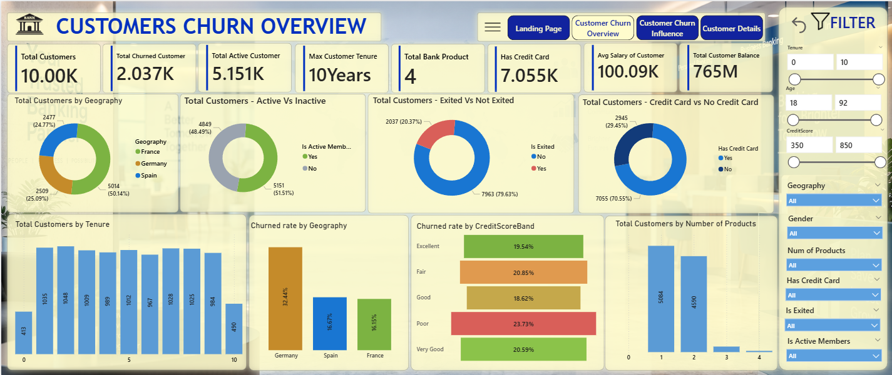
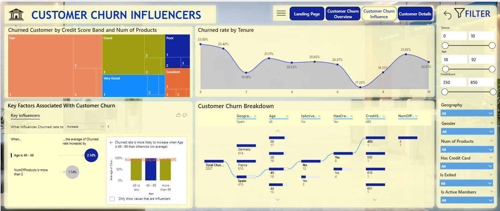
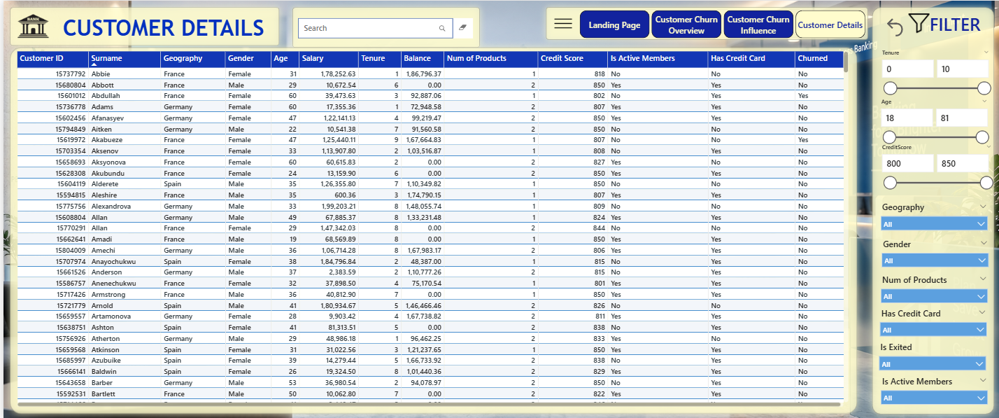

# Bank Customer Churn Analysis — Power BI Project

## Project Overview

This project analyzes bank customer data using Microsoft Power BI to understand customer churn, identify customer behaviour patterns, and explore the factors associated with customers leaving the bank.

The dashboard uses interactive visualizations, KPI cards, slicers, and AI-powered analytical visuals to help users explore customer demographics, account characteristics, churn patterns, and customer-level details.

## Dashboard Preview

### 1. Landing Page


### 2. Customer Churn Overview


This page provides a summary of customer distribution, active and inactive members, churn status, credit card ownership, tenure, geography, credit score bands, and the number of bank products.

### 3. Customer Churn Influencers


This page explores factors associated with churn using Key Influencers, churn-rate analysis by tenure, and a Decomposition Tree to investigate customer segments.

### 4. Customer Details


This page provides a detailed customer-level table with search and filtering options to explore individual customer records and churn status.

## Key Performance Indicators (KPIs)

The dashboard displays the following key metrics:

- **Total Customers:** 10,000
- **Total Churned Customers:** Approximately 2,037
- **Total Active Customers:** Approximately 5,151
- **Maximum Customer Tenure:** 10 years
- **Maximum Bank Products:** 4
- **Customers with Credit Cards:** Approximately 7,055
- **Average Customer Salary:** Approximately 100.09K
- **Total Customer Balance:** Approximately 765M

*Note: Values are based on the dashboard screenshots and may be affected by applied filters.*

## Key Analysis and Insights

- **Customer Churn:** Approximately 2,037 customers have churned, representing around 20.37% of the total 10,000 customers.
- **Geographical Distribution:** The dashboard compares customers across France, Germany, and Spain and highlights differences in customer churn rates by geography.
- **Customer Activity:** Active versus inactive membership and exited versus non-exited customer patterns can be explored interactively.
- **Credit Score Analysis:** Churn rates are compared across Excellent, Very Good, Good, Fair, and Poor credit score bands.
- **Tenure Analysis:** The relationship between customer tenure and churn rate is examined to identify patterns across different years of customer membership.
- **Customer Behaviour:** The Key Influencers visual highlights factors associated with churn, including customer age and the number of products held.
- **Customer-Level Exploration:** The detailed customer table supports searching and filtering individual records.

## Interactive Dashboard Features

- KPI cards for a quick overview of customer performance.
- Navigation between the Landing Page, Customer Churn Overview, Customer Churn Influencers, and Customer Details.
- Interactive filters for tenure, age, credit score, geography, gender, number of products, credit card ownership, exit status, and active membership.
- Key Influencers visual to investigate factors associated with customer churn.
- Decomposition Tree to drill into customer segments.
- Customer detail table with search functionality.

## Tools and Technologies Used

- **Microsoft Power BI** — Dashboard development and data visualization.
- **Power Query** — Data cleaning and transformation.
- **DAX** — KPI calculations and analytical measures.
- **Data Modeling** — Organizing customer data for reporting and analysis.
- **Power BI AI Visuals** — Key Influencers and Decomposition Tree.

## Project Folder Structure

```text
Bank-Customer-Churn-Analysis/
├── Dashboard_file/
│   └── Bank_Customer_Churn_Analysis.pbix
├── Dataset/
│   └── Bank_Customer_Churn_Dataset.csv
├── Screenshots/
│   ├── Bank_Customer_Churn_Landing_Page.png
│   ├── Customer_Churn_Overview.png
│   ├── Customer_Churn_Influencers.png
│   └── Customer_Details.png
└── README.md
```

*The filenames shown above are suggested names. Use your actual filenames when uploading files to GitHub.*

## How to View the Project

1. Open the `Dashboard_file/` folder in this repository.
2. Download the Power BI `.pbix` file.
3. Open the file using Microsoft Power BI Desktop.
4. If Power BI requests a data source location, update it to the dataset file in the `Dataset/` folder.
5. Use the navigation buttons and filters to explore the dashboard.

## Project Objective

The objective of this project is to demonstrate practical skills in data preparation, data modeling, DAX, interactive dashboard development, and customer churn analysis using Microsoft Power BI.

## Author

**Rishav Kumar**

- GitHub: [rishavkumar3333](https://github.com/rishavkumar3333)
- LinkedIn: [Rishav Kumar](https://www.linkedin.com/in/rishavkumar33)

---

If you find this project useful, feel free to explore the repository and share your feedback.
