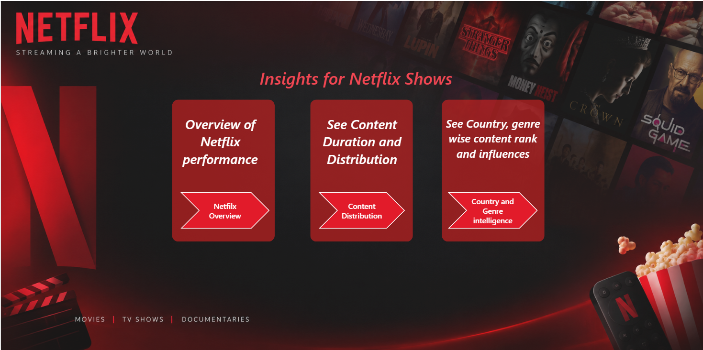
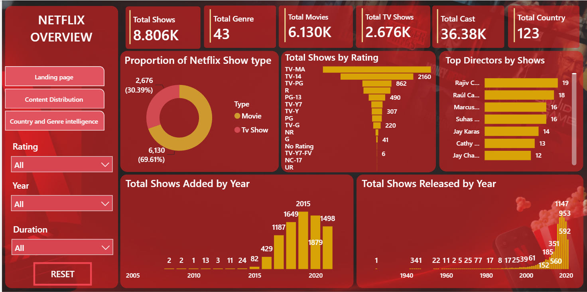
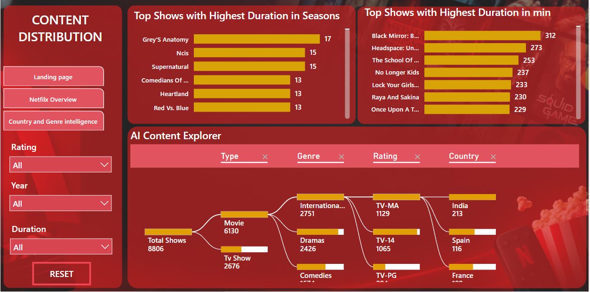

# Netflix Shows Analysis — Power BI Project

## Project Overview

This project analyzes Netflix movies and TV shows using Microsoft Power BI. The interactive dashboard explores content distribution, ratings, release trends, genres, directors, and country-wise availability to uncover useful insights about Netflix's catalogue.

## Dashboard Preview

### 1. Landing Page


### 2. Netflix Overview


### 3. Content Distribution


### 4. Country and Genre Intelligence


## Key Metrics

The dashboard presents the following metrics:

- **Total Shows:** 8,806
- **Movies:** 6,130
- **TV Shows:** 2,676
- **Genres:** 43
- **Cast Members:** 36.38K
- **Countries:** 123

*Metrics reflect the current dashboard and may vary with filters or counting methods.*

## Key Analysis

- Compared the distribution of movies and TV shows on Netflix.
- Analyzed content ratings to understand the catalogue's rating profile.
- Explored content additions and release-year trends.
- Identified leading directors, countries, and genres.
- Examined show duration and TV series seasons.
- Used Power BI's Key Influencers visual to explore factors associated with total shows.

## Tools and Technologies

- **Microsoft Power BI** — dashboard development and visualization
- **Power Query** — data cleaning and transformation
- **DAX** — measures and KPIs
- **Data Modeling** — fact, dimension, and bridge tables

## Project Structure

```text
Netflix_Shows_Analysis/
├── Dashboard_file/
│   └── Netflix_Analysis.pbix
├── Dataset/
│   └── netflix_titles.csv
├── Screenshots/
│   ├── Landing_Page.png
│   ├── Netflix_Overview.png
│   ├── Content_Distribution.png
│   └── Country_Genre_Intelligence.png
└── README.md
```

## Dataset

The project uses `netflix_titles.csv`, containing information about Netflix movies and TV shows, including titles, directors, cast, countries, genres, ratings, release years, and durations.

Please refer to the original dataset source for its licensing and redistribution terms.

## How to View the Project

1. Open the `Dashboard_file/` folder.
2. Download the Power BI `.pbix` file.
3. Open it using Microsoft Power BI Desktop.
4. If prompted, update the dataset source path to the downloaded `netflix_titles.csv` file.
5. Refresh the data if required.

## Author

**Rishav Kumar**

- GitHub: [rishavkumar3333](https://github.com/rishavkumar3333)
- LinkedIn: [Rishav Kumar](https://www.linkedin.com/in/rishavkumar33)
